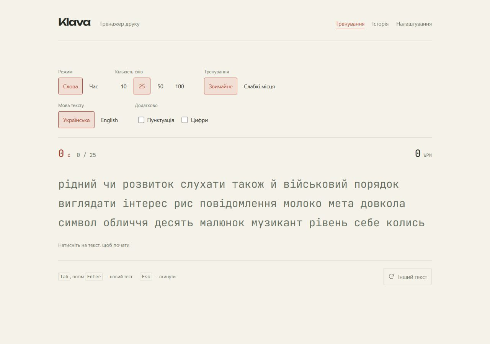
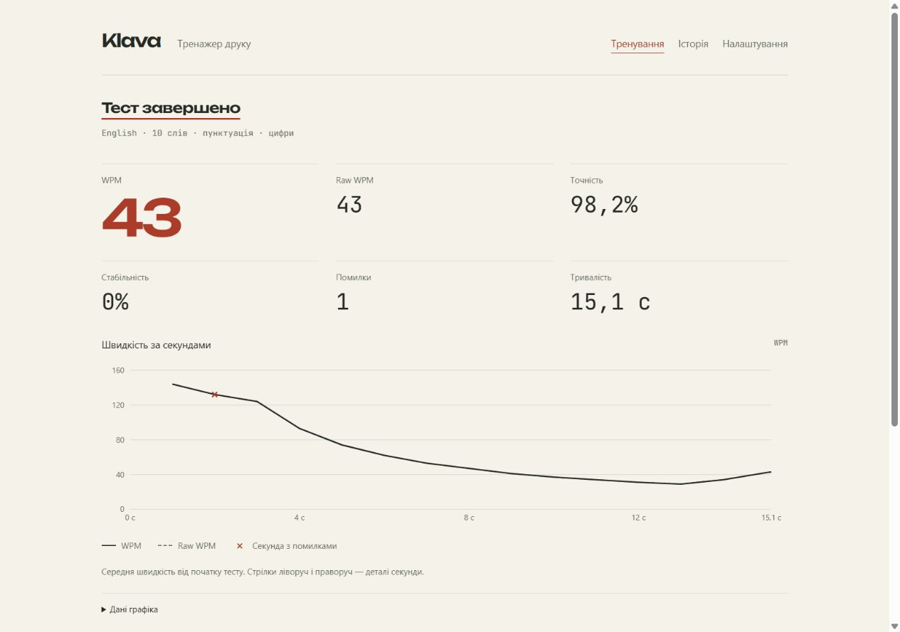
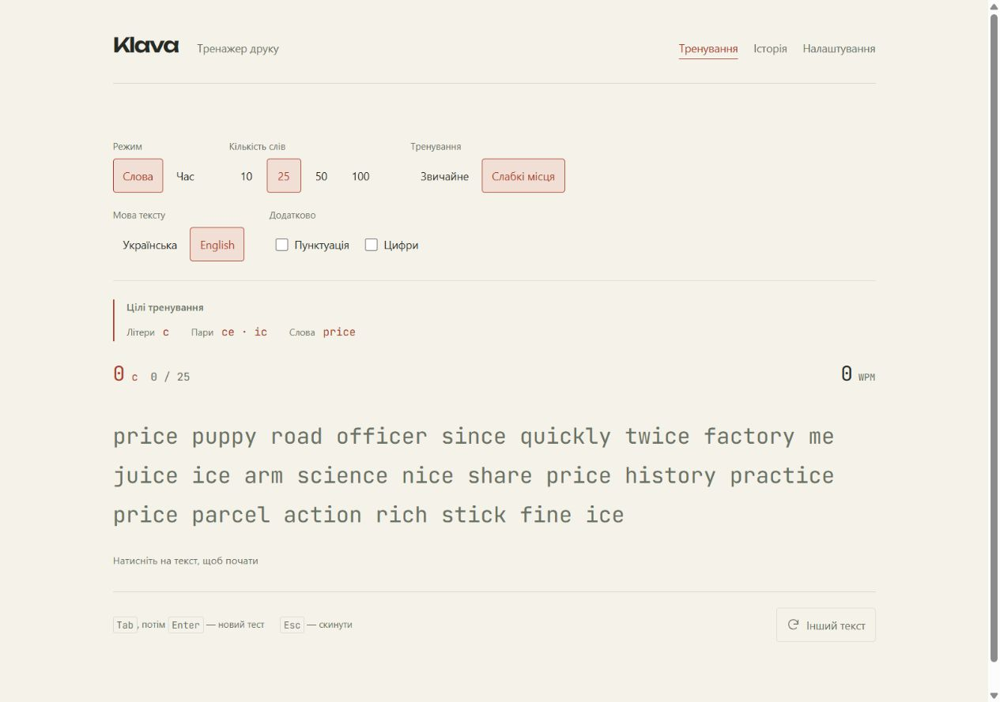

# Klava

Тренажер швидкості друку українською та англійською.

[Відкрити Klava](https://nicholas-nak.github.io/klava/)



## Можливості

- Тести на 15, 30, 60 або 120 секунд і на 10, 25, 50 або 100 слів.
- Українська й англійська мови, пунктуація та цифри.
- Підсвітка правильних, помилкових і зайвих символів; живий WPM і таймер.
- WPM, raw WPM, точність, стабільність і графік швидкості з позначками помилок.
- Історія, прогрес за днями й особисті рекорди для кожного набору параметрів.
- Теплова карта української та англійської розкладок і тренування «Слабкі місця».
- Світла й темна теми, три розміри тексту та режим при відкритті.

Під час друку панель керування ховається. На телефоні введення працює через звичайне поле `input`, яке відкриває екранну клавіатуру. Апострофи `'` і `’` рівнозначні; ґ, є, ї та і — окремі літери.

## Керування

Натисніть на текст і почніть друкувати. Таймер запускається з першого символу.

| Клавіші          | Дія                         |
| ---------------- | --------------------------- |
| Пробіл або Enter | Перейти до наступного слова |
| Backspace        | Виправити поточне слово     |
| Tab, потім Enter | Почати новий тест           |
| Esc              | Скинути тест                |

На графіках стрілки ліворуч і праворуч показують деталі точки. Ті самі значення доступні в таблицях під графіками.

## Слабкі місця

Режим аналізує останні 30 тестів обраної мови: помилки в літерах, парах літер і словах, включно з виправленими. Перед початком видно, що саме тренуватиметься.

Генератор частіше обирає слова з цими комбінаціями й додає звичайні слова для різноманітності. Якщо історії помилок ще немає, використовується звичайний список. Вибір слів — чиста функція з окремими тестами.

## Показники

| Показник     | Як рахується                                                                                           |
| ------------ | ------------------------------------------------------------------------------------------------------ |
| WPM          | Правильні символи, що залишилися в тексті, поділені на 5 і на час у хвилинах. Пробіли враховуються.    |
| Raw WPM      | Та сама формула для всіх символів, що залишилися, включно з помилковими й зайвими.                     |
| Точність     | Частка правильних спроб. Виправлені помилки та пропуски при переході між словами теж враховуються.     |
| Стабільність | Рівномірність темпу введення за повними секундами, включно з паузами. Потрібно щонайменше дві секунди. |

Графік показує середню швидкість від початку тесту. Позначки помилок стосуються окремої секунди. Видалені символи показуються окремо й не додаються до raw WPM.

## Збереження даних

Налаштування та останні 200 результатів зберігаються в `localStorage` цього браузера. Особисті рекорди зберігаються окремо, тому залишаються після виходу старого тесту з історії. Мова, режим, тривалість або кількість слів, пунктуація, цифри та тип тренування мають окремі рекорди.

Синхронізації між пристроями немає. Очищення даних сайту видаляє історію й налаштування.

<details>
<summary>Результат тесту й адаптивне тренування</summary>





</details>

## Запуск

Потрібні Node.js 24 і npm.

```sh
npm ci
npm run dev
```

Відкрийте [127.0.0.1:5173/klava/](http://127.0.0.1:5173/klava/).

```sh
npm run check       # перевірка коду, форматування, тести та збірка
npm run test:watch  # тести під час розробки
npm run preview    # перегляд зібраної версії
```

Для окремої збірки: `npm run build`. Перегляд збірки доступний за адресою [127.0.0.1:4173/klava/](http://127.0.0.1:4173/klava/).

## Стек

Vite, React, TypeScript у strict-режимі, React Router і CSS Modules. Стан тесту керується через `useReducer`, налаштування та історія — через Zustand. Графіки побудовані на Recharts. Тести: Vitest і React Testing Library; перевірка стилю коду: ESLint і Prettier.

Генерація тексту, reducer і розрахунок показників розташовані в `src/domain`. Власні списки поширених слів — у [`src/data/uk.json`](src/data/uk.json) і [`src/data/en.json`](src/data/en.json), понад 1000 слів у кожному.

Шрифти: [JetBrains Mono](public/licenses/jetbrains-mono.txt) для тексту тесту та [Unbounded](public/licenses/unbounded.txt) для заголовків. Обидва постачаються із застосунком.

## Публікація

[GitHub Actions](.github/workflows/deploy.yml) перевіряє кожен push у `main` і pull request. Успішна перевірка `main` публікує збірку на GitHub Pages.

У налаштуваннях Pages обрано **GitHub Actions**. Застосунок використовує `HashRouter` і `base: '/klava/'` у `vite.config.ts`; для іншої назви репозиторію потрібно змінити `base`.
