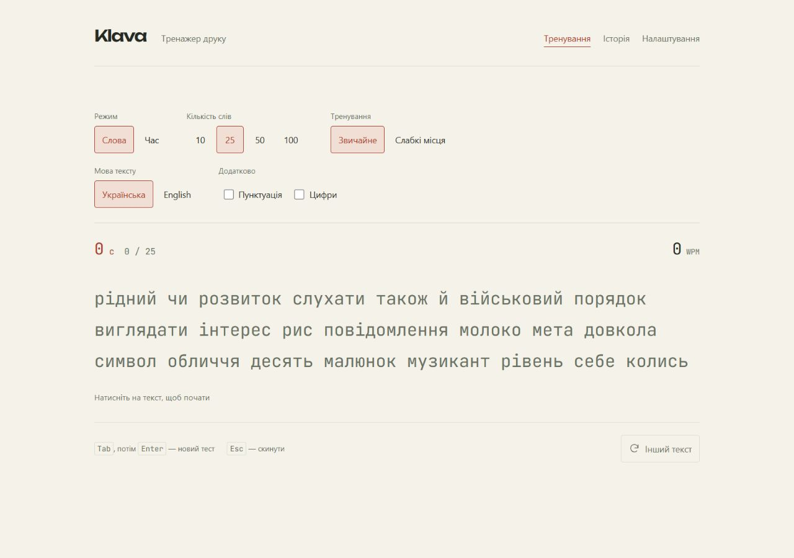
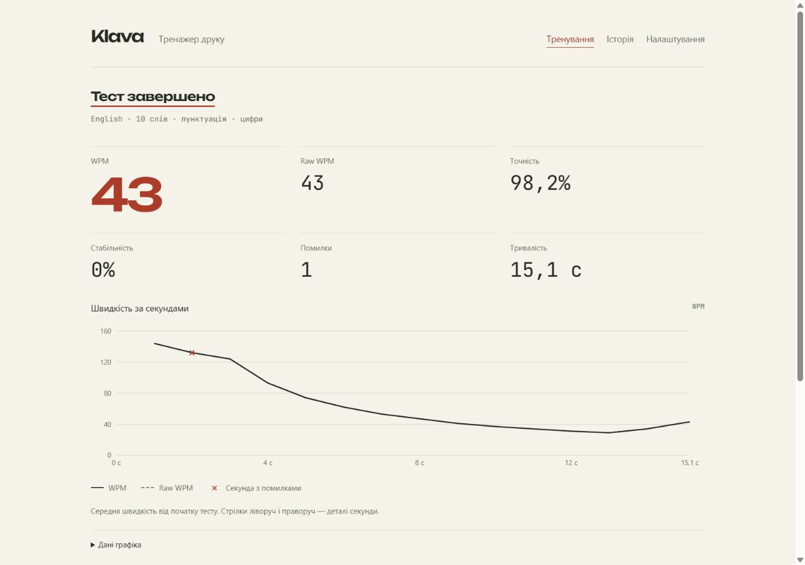
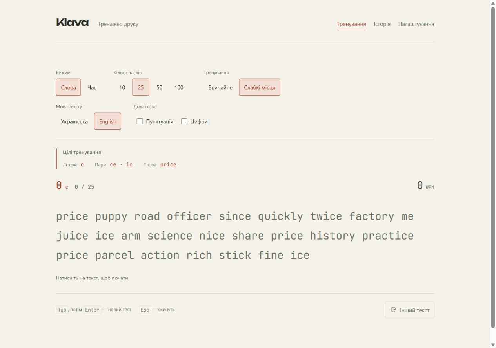

# Klava

A typing speed trainer for Ukrainian and English, built with React and TypeScript.

[**Live demo →**](https://nicholas-nak.github.io/klava/)



| Test results                                                                                  | Weak spots practice                                                                                  |
| --------------------------------------------------------------------------------------------- | ---------------------------------------------------------------------------------------------------- |
|  |  |

## Features

- Timed tests (15, 30, 60, 120 s) and word-count tests (10, 25, 50, 100 words).
- Ukrainian and English word lists, optional punctuation and numbers.
- Live highlighting of correct, incorrect and extra characters; live WPM and timer.
- Results: WPM, raw WPM, accuracy, consistency and a speed chart with error markers.
- History, daily progress and personal records for every combination of test settings.
- Keyboard error heatmap for both layouts and an adaptive **Weak spots** practice mode.
- Light and dark themes, three text sizes and a configurable default mode.

The control panel hides while you type. On mobile, input goes through a regular `input` field so the on-screen keyboard opens. The apostrophes `'` and `’` are treated as equal; ґ, є, ї and і are separate letters.

## Testing

The project has **35 test files** written with **Vitest** and **React Testing Library**. Tests sit next to the code they check (`metrics.ts` → `metrics.test.ts`) and cover every layer of the app:

| Layer             | Folder                   | Test files | What is checked                                                                                                                         |
| ----------------- | ------------------------ | ---------- | --------------------------------------------------------------------------------------------------------------------------------------- |
| Domain logic      | `src/domain/`            | 14         | WPM, accuracy and consistency formulas, mistake classification, test reducer, records, history, weak-spot selection and text generation |
| UI components     | `src/components/`        | 10         | Typing area, passage and word highlighting, results, charts, heatmap, history table, chart error boundary                               |
| State and storage | `src/stores/`            | 4          | Zustand stores and validation of data restored from `localStorage`                                                                      |
| App flows         | `src/app/`, `src/pages/` | 6          | Full user flows: typing a test, settings, keyboard shortcuts, adaptive mode, history page, chart loading failures                       |
| Data              | `src/data/`              | 1          | Word list integrity                                                                                                                     |

Pure calculation logic lives in `src/domain` with no React dependencies, so most of it is covered by fast, deterministic unit tests. Component and app-level tests use `user-event` to simulate real typing and keyboard navigation.

```sh
npm test             # run all tests once
npm run test:watch   # re-run tests on file changes
npm run check        # lint + format check + tests + production build
```

### Continuous integration

A [GitHub Actions workflow](.github/workflows/deploy.yml) runs `npm run check` (ESLint, Prettier, Vitest and the TypeScript build) on every push and pull request to `main`. The site is deployed to GitHub Pages only when all checks pass.

## Controls

Click the text and start typing. The timer starts on the first character.

| Keys            | Action               |
| --------------- | -------------------- |
| Space or Enter  | Next word            |
| Backspace       | Fix the current word |
| Tab, then Enter | Start a new test     |
| Esc             | Reset the test       |

On charts, the left and right arrow keys show point details. The same values are available in tables below the charts.

## Weak spots

This mode analyses the last 30 tests in the selected language: mistakes in letters, letter pairs and words, including corrected ones. Before the test starts, it shows exactly what will be practised.

The generator favours words containing those combinations and mixes in regular words for variety. If there is no mistake history yet, the regular word list is used. Word selection is a pure function with its own tests.

## Metrics

| Metric      | How it is calculated                                                                                            |
| ----------- | --------------------------------------------------------------------------------------------------------------- |
| WPM         | Correct characters remaining in the text, divided by 5 and by the time in minutes. Spaces count.                |
| Raw WPM     | The same formula for all remaining characters, including incorrect and extra ones.                              |
| Accuracy    | Share of correct keystrokes. Corrected mistakes and skipped characters when moving to the next word also count. |
| Consistency | How even the typing pace is across full seconds, including pauses. Needs at least two seconds.                  |

The chart shows average speed from the start of the test. Error markers refer to a single second. Deleted characters are shown separately and are not added to raw WPM.

## Data storage

Settings and the last 200 results are stored in this browser's `localStorage`. Personal records are stored separately, so they remain after old tests leave the history. Language, mode, duration or word count, punctuation, numbers and practice type each have their own records.

There is no sync between devices. Clearing site data removes history and settings.

## Getting started

Requires Node.js 24 and npm.

```sh
npm ci
npm run dev
```

Open [127.0.0.1:5173/klava/](http://127.0.0.1:5173/klava/).

```sh
npm run build     # production build
npm run preview   # preview the build at 127.0.0.1:4173/klava/
```

## Tech stack

- **App:** Vite, React, TypeScript (strict mode), React Router, CSS Modules
- **State:** `useReducer` for the running test, Zustand for settings and history
- **Charts:** Recharts
- **Quality:** Vitest, React Testing Library, ESLint, Prettier, GitHub Actions

Text generation, the test reducer and metric calculations are in `src/domain`. Custom lists of common words are in [`src/data/uk.json`](src/data/uk.json) and [`src/data/en.json`](src/data/en.json), with over 1000 words each.

Fonts: [JetBrains Mono](public/licenses/jetbrains-mono.txt) for test text and [Unbounded](public/licenses/unbounded.txt) for headings. Both are bundled with the app.

## Deployment

The app uses `HashRouter` and `base: '/klava/'` in `vite.config.ts`. If you rename the repository, update `base`. In the repository's Pages settings, the source is set to **GitHub Actions**.
